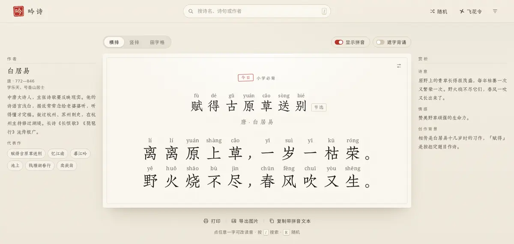
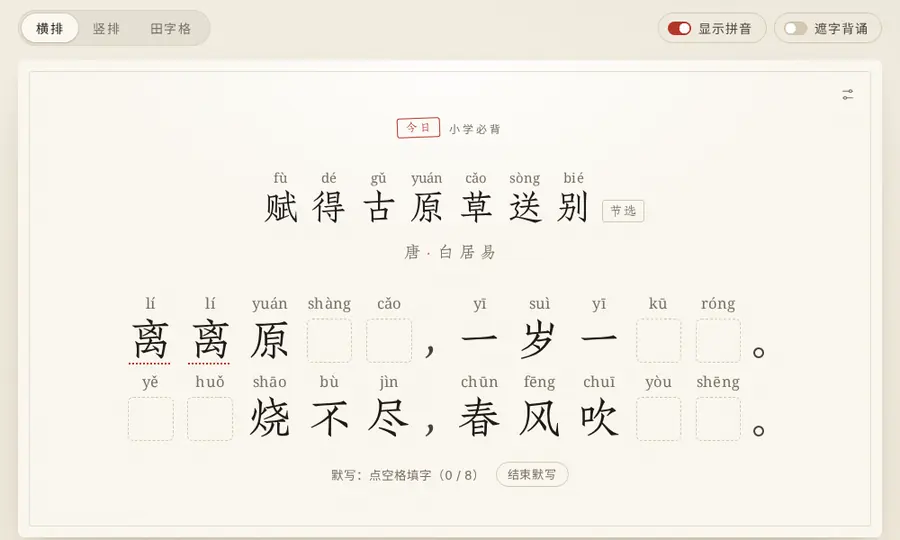
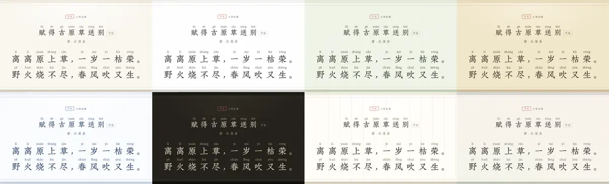
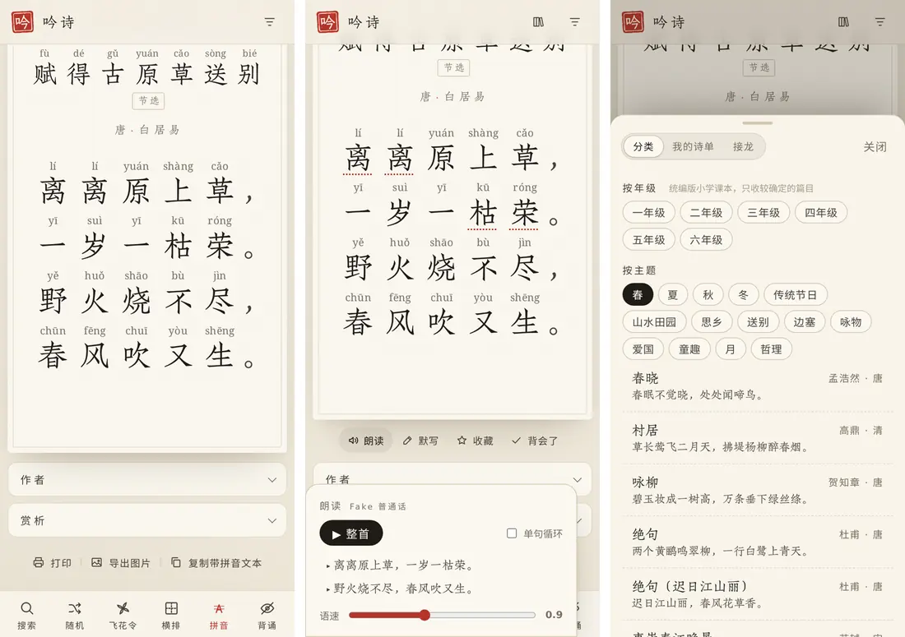

<p align="center"></p>

<h1 align="center">吟诗</h1>

<p align="center">一张宣纸，一首诗，字上带拼音。给孩子读诗，给自己温诗。</p>

<p align="center"><a href="https://ttnan.github.io/yinshi/"><b>打开吟诗 → ttnan.github.io/yinshi</b></a></p>

<p align="center"></p>

吟诗是一个打开就能用的网页：首页是「今日一诗」，每个字上方标着带声调的拼音，可以横排、竖排、田字格三种方式读，也能遮字背诵、默写、听朗读、玩飞花令和接龙。不用注册，不装软件，所有记录都留在你自己的浏览器里。

## 功能

### 阅读与拼音

- **今日一诗**：内置 72 首小学必背古诗（统编版课本文本），每天轮换一首；逢春节、清明、重阳和二十四节气（按北京时间），优先换上应景的诗。
- **三种版式**：横排（拼音在字上方、长句不拆开）、竖排（从右往左或从左往右）、田字格（四线三格拼音格 + 米字虚线田字格，适合描红）。
- **读音更准**：课本读音修正（如 朝辞白帝 zhāo、千里江陵一日还 huán）默认打开；吟诵旧读（斜 xiá、衰 cuī）可选；任何一个字都可以点开改读音，按这首诗记住。
- **点词看注释**：收录赏析的诗里，难懂的词下面有朱色虚线，点一下先看释义，再选读音。
- **作者与赏析**：宽屏时诗笺左边是作者生平（朝代、生卒年、字号、简介、代表作），右边是诗意、情感、创作背景和「相关的诗」；手机上收在诗笺下方，点开再看。
- **平仄标注（参考）**：五七言绝句、律诗可以在每个字下标出平（—）仄（|），常见入声字按仄声标出。
- **简体 / 繁體** 一键切换，注音、注释、赏析一起转换。

### 学习与背诵

- **朗读**：用系统自带的中文语音读整首或单句，字随声音逐个点亮；语速 0.5–1.5，可以单句循环。设备上没有中文语音时按钮自动隐藏。
- **遮字背诵**：诗句被墨晕遮住，点一句显示、再点遮住；切换版式、简繁、拼音时不会闪出原字。
- **默写**：随机挖掉一些字，点空格从四个字里选，或者自己写；写完给出得分，写错的字标红。
- **收藏与背诵打卡**：喜欢的诗点「收藏」，背会了点「背会了」，之后按 1、2、4、7、15 天提醒复习，首页会提示今天该复习哪几首。
- **分类找诗**：按年级（统编版，只收较确定的篇目）和主题（四季、传统节日、山水田园、思乡、送别、边塞、咏物、爱国、童趣……）浏览课本诗。

<p align="center"></p>

### 找诗与游戏

- **搜索**：诗名、诗人、诗句都能搜。按诗人搜索时列出「某某的诗」，可以一直加载更多——李白 1000 多首、杜甫近 1500 首。
- **随机**：可按朝代、诗 / 词 / 曲、诗人筛选。
- **飞花令**：出一个字，随机来一首含这个字的诗，诗里这个字用朱砂色标出。
- **诗词接龙**：电脑出一句，你从三句里挑出以上一句最后一个字开头的那句。

### 个性化与分享

- **8 种字体**：仿宋（朱雀仿宋，默认）、宋体、楷体、黑体、小薇、毛笔、快乐、行书；只下载选中的那一种。
- **字号、拼音大小、行距** 可调，放大后句子在格内换行、不裁切。
- **7 种纸面**：宣纸、素笺、竹简、绢本、青花、夜读（深色）、信笺，纹理都是自己绘制的；还可以上传一张自己的照片当背景，调节遮罩浓淡，随时移除。
- **打印与导出**：打印干净的 A4，可勾选拼音、大字、译文、注释、赏析；导出 PNG 图片（跟随纸面，带落款小印）；复制带拼音的文本。

<p align="center"></p>
<p align="center"></p>

## 隐私

- 不需要账号，没有统计脚本。
- 收藏、背诵打卡、改过的读音、字体与纸面等设置都只存在你这台设备的浏览器里（localStorage）。
- 自定义背景图在本机缩小后存进浏览器的 IndexedDB，**不会上传到任何地方**。
- 搜索、随机、飞花令时，浏览器会直接访问下面列出的公开诗词接口和 CDN（没有任何中转服务器），只发送你输入的查询词。

## 数据来源与致谢

| 内容 | 来源 | 许可 |
| --- | --- | --- |
| 诗词检索、随机（主诗库） | [snowtraces/poetry-source](https://github.com/snowtraces/poetry-source) 的公共接口 `poetry-api.snowtraces.com` | 运行时调用，仓库不含其代码 |
| 唐诗、宋诗 | [chinese-poetry/chinese-poetry](https://github.com/chinese-poetry/chinese-poetry)：仓库只含由它生成的索引（`site/data/cp/`），诗的正文运行时从 [unpkg](https://unpkg.com/chinese-poetry@2.0.1/)（备用 raw.githubusercontent.com）读取 | MIT |
| 备用诗库、单字与飞花令 | [诗泉 palemoky/chinese-poetry-api](https://github.com/palemoky/chinese-poetry-api) 的公共实例 `poetry.palemoky.com` | 运行时调用 |
| 小学必背 72 首 | 统编版课本文本（古诗为公有领域作品） | — |
| 作者生平、诗意赏析、注释、分类 | 吟诗原创撰写（`tools/content/`） | MIT |
| 拼音 | [pinyin-pro](https://github.com/zh-lx/pinyin-pro) | MIT |
| 简繁转换 | [opencc-js](https://github.com/nk2028/opencc-js)（词典来自 OpenCC） | MIT / Apache-2.0 |
| 字体 | [朱雀仿宋](https://github.com/TrionesType/zhuque)（本站托管分片版，来自 [中文网字计划](https://chinese-font.netlify.app)）、[霞鹜文楷](https://github.com/lxgw/LxgwWenKai)、思源宋体 / 思源黑体（Noto Serif SC / Noto Sans SC）、站酷小薇、马善政楷书、站酷快乐体、龙藏体、Noto Serif（拼音） | SIL OFL 1.1 |

感谢以上项目的作者与维护者。也感谢 [tjsky/pinyin-annotator](https://github.com/tjsky/pinyin-annotator) 带来的最初灵感（吟诗是独立重写的项目，不含它的代码）。完整的第三方许可见 [LICENSE](LICENSE)。

## 本地运行

网站就是 `site/` 目录里的静态文件，不需要构建：

```bash
python3 -m http.server -d site 8080    # 然后打开 http://localhost:8080
```

（直接双击 `index.html` 时浏览器不允许读取 JSON，需要像上面这样起一个本地服务。）部署到任何静态托管都可以：把 `site/` 作为网站根目录。本仓库用 GitHub Actions 发布到 GitHub Pages。

常用维护命令：

```bash
sh tools/bump-version.sh                 # 发版前更新 index.html 里的 ?v= 版本号
node tools/build-cp-index.mjs            # 重新生成唐诗宋诗索引（下载 npm 包 chinese-poetry@2.0.1）
python3 tools/content/build.py           # 由 tools/content/ 生成作者、赏析、分类数据
```

诗词接口地址、限流与超时在 `site/poem/config.js`；读音修正表在 `site/poem/poem-readings.json`（每条 `{"p": "[朝]辞白帝", "r": "zhāo"}`，用 `[ ]` 标出要修正的字，整段片段出现时才生效）。

## 测试

```bash
pip install playwright && python3 -m playwright install chromium
python3 tests/e2e.py              # 无头浏览器验收（录好的接口数据，不联网）；YINSHI_PART=base / v3 / v4 / v5 / visual 分段
python3 tests/live_api.py         # 真实接口与 CDN：返回结构、跨域头
python3 tests/live_browser.py https://ttnan.github.io/yinshi/   # 真实浏览器直连线上站点
```

## 许可

代码与原创内容：MIT © 2026 Caesar (TTNAN)，见 [LICENSE](LICENSE)。
